<p align="center">
  
</p>

<p align="center">
  <a href="mailto:elyes.sawak@gmail.com"></a>
  
  
  
</p>


## 👋 About me

```kotlin
data class Developer(
    val name: String      = "Ilyes Saouak",
    val location: String  = "Hannover, Germany",
    val role: String      = "Software Developer",
    val builds: List<String> = listOf("Android apps", "Flutter apps", "Full-stack web apps"),
    val favorites: List<String> = listOf("Kotlin", "TypeScript", "Dart"),
    val status: String    = "Open for projects 🚀",
)
```

- I build **mobile apps** (Kotlin, Flutter) and **web apps** (Angular, Next.js, TypeScript).
- Latest project: [**Wi-Fi Extender**](https://github.com/ilyesaouak/wifiextender), which turns an old Android phone into a Wi-Fi extender, no root needed.
- Got a project or an idea? [Send me an email](mailto:elyes.sawak@gmail.com).


## Tech stack

<p align="center">
  
  <br/><br/>
  
</p>


## Featured projects

<p align="center">
  <a href="https://github.com/ilyesaouak/wifiextender"></a>
  <a href="https://github.com/ilyesaouak/farehunt"></a>
  <a href="https://github.com/ilyesaouak/3D-Animated-Portfolio"></a>
  <a href="https://github.com/ilyesaouak/University-Managment-Platform"></a>
  <a href="https://github.com/ilyesaouak/MealPrep-Web-App"></a>
  <a href="https://github.com/ilyesaouak/Etude_manager"></a>
</p>


## GitHub stats

<p align="center">
  
  
</p>
<p align="center">
  
</p>


